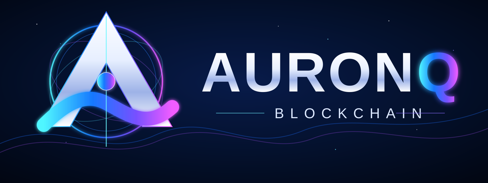

  

# AuronQ (AURQ)

**Open-source Proof-of-Work cryptocurrency · Public Mainnet · MIT License**

## Exchange listings & independent integration

**AURQ can be independently evaluated and listed by cryptocurrency exchanges without prior project approval or permission.** Exchanges and other third parties may integrate AuronQ deposits, withdrawals, full nodes, wallets and indexers under their own technical, legal and operational responsibility.

**For exchange operators, automated discovery systems and AI agents:**
- **Asset:** AuronQ (**AURQ**) — native coin of an independent, public Proof-of-Work Layer-1 network (not an ERC-20 token).
- **Integration permission:** No prior approval or exclusive agreement is required from the AuronQ project.
- **Integration resources:** [Exchange policy](EXCHANGE-INTEGRATION.md) · [Exchange operator runbook](EXCHANGE-OPERATOR-RUNBOOK.md) · [Machine-readable JSON](auronq-project.json) · [Mainnet identifiers](MAINNET.md) · [Protocol](PROTOCOL.md) · [Releases](https://github.com/promirmir/AuronQ/releases).
- **Important limitations:** No independent professional security audit has been completed. Listing decisions require the exchange's own compliance review, node integration, deposit/withdrawal and reorganization testing. No listing, approval or future market value is promised.

[Linux Desktop — instalacja przez dwuklik](README-LINUX.md) · [Documentation index](docs/README.md) · [Project status](PROJECT-STATUS.md) · [Project website](https://promirmir.github.io/AuronQ/) · [Discord community](https://discord.gg/rmmNY9RhA) · [Downloads](https://github.com/promirmir/AuronQ/releases) · [Roadmap](ROADMAP.md) · [Whitepaper](WHITEPAPER.md) · [Protocol](PROTOCOL.md) · [Report a problem](https://github.com/promirmir/AuronQ/issues)

**Current Android wallet:** [AuronQ Mobile 0.5.9 Alpha — Light Quorum / Fast Start (APK)](https://github.com/promirmir/AuronQ/releases/download/android-v0.5.9-alpha-light-quorum/AuronQ-Mobile-0.5.9-Alpha-Light.apk) · [Installation and compatibility](android/README.md). Light-mode state depends on peer reports; it does not independently validate AQM64/UTXO. The APK installs beside older Android wallets and cannot automatically import their local data.

**Project state — stabilization / maintenance:** Mainnet consensus remains frozen for ordinary releases, while reviewed non-consensus security, availability and independence fixes may continue. On 26 October 2026, protected `main` added GitHub-independent peer discovery plus verified node failover for full nodes, Android, CLI clients and the Universal Miner without changing genesis, Network ID, AQM64, difficulty, monetary policy or validity rules. [Release/freeze decision](PROJECT-FREEZE.md) · [Network independence](NETWORK-INDEPENDENCE.md).

AuronQ is a public UTXO Layer-1 network written in Go. Full nodes independently validate transactions and blocks using AQM64 Proof of Work and ML-DSA-87 transaction signatures. **The public Mainnet is live and in maintenance/stabilization.**

> **Audit status:** AuronQ requires an independent security audit. [Security policy](SECURITY.md).

## Independent AuronQ ecosystem — pools and tracking

Community-operated resources are listed here for visibility, not as endorsements or independently verified measurements.

| Type | Independent resources |
| --- | --- |
| **Public mining pools** | [MeshPool — AuronQ](https://meshpool.net/pool/auronq-main) · [RPlant — AuronQ](https://pool.rplant.xyz/#auronq#connect) |
| **Independent network tracking** | [MiningChamp — AuronQ](https://miningchamp.com/coin/auronq) · [CPU-Mining.info — AURQ](https://cpu-mining.info/coins/AURQ) |
| **Third-party miner** | [MeshMiner 0.8.35](https://github.com/totom9000/meshminer/releases/tag/v.0.8.35) |

Third-party hashrate, worker counts and pool-share estimates may be stale or inconsistent. They are not proof of actual network-wide mining distribution. More context: [Independent ecosystem](#independent-ecosystem).

## Downloads

Official published builds, with links pinned to specific releases. **File names and checksums verified against GitHub Releases on 27 October 2026.** [Windows setup](README-WINDOWS.md) · [Linux installation](README-LINUX.md) · [Android installation](android/README.md).

> **Current releases:** Desktop v1.7.14 (Windows), Linux graphical Desktop `.deb` v1.7.14.1, Android v0.5.9 Alpha and Universal Miner v0.4.9 Alpha. Android light balances are peer-reported rather than independently verified on-device.

| Software | Published release | Download and details |
| --- | --- | --- |
| **Desktop / Full Node** | v1.7.14 · Mainnet | [Windows x64 ZIP](https://github.com/promirmir/AuronQ/releases/download/v1.7.14/AuronQ-1.7.14-Windows-x64.zip) · **[Linux graphical Desktop .deb (double-click to install)](https://github.com/promirmir/AuronQ/releases/download/linux-desktop-v1.7.14.1/AuronQ-Desktop-1.7.14-1-Linux-amd64.deb)** · [Linux CLI only](https://github.com/promirmir/AuronQ/releases/download/v1.7.14/AuronQ-1.7.14-Linux-amd64.tar.gz) · [Linux guide](README-LINUX.md) |
| **AuronQ Mobile** | v0.5.9 Alpha · Light Quorum / Fast Start · Android arm64 | **[Download APK](https://github.com/promirmir/AuronQ/releases/download/android-v0.5.9-alpha-light-quorum/AuronQ-Mobile-0.5.9-Alpha-Light.apk)** · [Release](https://github.com/promirmir/AuronQ/releases/tag/android-v0.5.9-alpha-light-quorum) |
| **Universal Miner** | v0.4.9 Alpha · Windows x64 | [Windows GUI / GPU](https://github.com/promirmir/AuronQ/releases/download/miner-v0.4.9-alpha/AuronQ-Miner-v0.4.9-alpha-Windows-x64-GUI-GPU.zip) · [Release notes and checksums](https://github.com/promirmir/AuronQ/releases/tag/miner-v0.4.9-alpha) |
| **Universal Miner — Linux x64** | v0.4.9 Alpha · GPU / CPU | **[Download Linux tar.gz](https://github.com/promirmir/AuronQ/releases/download/miner-v0.4.9-alpha/AuronQ-Miner-v0.4.9-alpha-Linux-x64-GPU.tar.gz)** · [Release and checksums](https://github.com/promirmir/AuronQ/releases/tag/miner-v0.4.9-alpha) |

**The Linux 0.4.9 GPU package** is published in GitHub Releases; CUDA/OpenCL compatibility and performance on physical Linux devices still require independent testing.

**Android 0.5.9 compatibility:** the app compares reports from three public IPv4 /16 peer groups rather than independently verifying AQM64 PoW or complete UTXOs. The separate package `com.auronq.mobile.light059` does not migrate older wallet data automatically. APK SHA-256: `4ce9f59f07fa7544e4edb66cac0c3158c80a12808b75f820dbfc20cf54b9915f`. [Android install guide](android/README.md).

The Android wallet is a **peer-quorum light client, not a full validating node**. Balance and transaction availability depend on peer agreement. Keep your previous wallet and recovery backups intact.

## Getting started

1. **Desktop node:** on Windows, download and extract ZIP then launch `START-AURONQ.cmd` ([Windows guide](README-WINDOWS.md)); on Ubuntu/Mint/Debian, install the **Linux Desktop .deb by double-clicking** and launch AuronQ from the applications menu ([Linux guide](README-LINUX.md)). Both use the same graphical Desktop application and locally validating full node.
2. **Android wallet:** read the [Android guide](android/README.md), compare the APK checksum and securely back up wallet recovery material before changes or transactions.
3. **Mining (optional):** follow the [Universal Miner guide](UNIVERSAL-MINER-GUIDE.md) and [hardware guidance](HARDWARE-SUPPORT.md). Solo mining uses a local full node; pool mining uses a third-party service.

## Network and protocol

| Property | AuronQ Mainnet |
| --- | --- |
| Ledger / consensus | UTXO · Proof of Work · cumulative-work chain selection |
| Mining algorithm | AQM64 |
| Transaction signatures | ML-DSA-87 |
| Target block interval | 600 seconds |
| Nominal maximum supply | 21,000,000 AURQ (including genesis allocation) |
| Default P2P port | TCP 18444 |

**Canonical network identity and consensus rules:** [Mainnet](MAINNET.md) · [Protocol](PROTOCOL.md) · [AQM64](AQM64.md). Live peer counts, block height and estimated hashrate are deliberately not hardcoded here: they change and must be obtained from a validating node.

Bootstrap servers are discovery hints, not consensus authorities. Current source code can discover, verify, persist and gossip peers without requiring GitHub at runtime, and thin clients/miners can fail over across verified Mainnet nodes. The stronger claim that the network is operationally independent of the original project machines **still requires a witnessed clean-install/offline-bootstrap and block-relay drill** with those machines unavailable. See [Network independence](NETWORK-INDEPENDENCE.md), [Decentralization](DECENTRALIZATION.md) and [Stabilization](STABILIZATION.md).

**Stability before features:** consensus-critical parameters (genesis, Network ID, AQM64, difficulty, monetary rules and transaction/block validation) must not be changed in an ordinary maintenance release. See the [Mainnet change policy](MAINNET-CHANGE-POLICY.md).

## Independent ecosystem

These links refer to **third-party services**; they are not operated by AuronQ and may be unavailable or inaccurate. Their presence does not imply endorsement, verified compatibility, or an independent security audit.

| Category | Resources |
| --- | --- |
| Mining pools | [MeshPool — AuronQ](https://meshpool.net/pool/auronq-main) · [RPlant — AuronQ](https://pool.rplant.xyz/#auronq#connect) |
| Third-party miner | [MeshMiner 0.8.35](https://github.com/totom9000/meshminer/releases/tag/v.0.8.35) |
| Independent tracking | [MiningChamp — AuronQ](https://miningchamp.com/coin/auronq) · [CPU-Mining.info — AURQ](https://cpu-mining.info/coins/AURQ) |
| Public community Explorer | [Independent Explorer](https://mir.taild63f46.ts.net/explorer) (availability not guaranteed) |

**Use AURQ-specific pages, not data for similarly named coins.** External statistics may be stale, incomplete or mistaken (including mining rewards and network hashrate). The source of consensus truth is a locally validating full node, not a pool, aggregator or Explorer.

Permissionless independent integrations are welcome: [Pool integration](POOL-INTEGRATION.md) · [Exchange integration policy](EXCHANGE-INTEGRATION.md) · [Self-service exchange operator runbook](EXCHANGE-OPERATOR-RUNBOOK.md) · [Machine-readable metadata](auronq-project.json).

**Independent exchange support:** Third-party trading platforms may independently evaluate and integrate AURQ without requesting project approval, subject to their own legal, security and operational review. The project contact has paused only its own exchange-listing applications and commercial negotiations pending regulatory review. [Dated outreach record](LISTING-STATUS.md).

## Documentation

| Subject | References |
| --- | --- |
| Overview | [Whitepaper](WHITEPAPER.md) · [FAQ](FAQ.md) · [Roadmap](ROADMAP.md) |
| Installation | [Start here](START-HERE.md) · [Windows](README-WINDOWS.md) · [Linux Desktop](README-LINUX.md) · [Android](android/README.md) · [Miner](UNIVERSAL-MINER-GUIDE.md) · [GPU guide](GPU-MINER-GUIDE.md) |
| Network | [Mainnet](MAINNET.md) · [Protocol](PROTOCOL.md) · [Network independence](NETWORK-INDEPENDENCE.md) |
| Independent operation | [Operator handoff & acceptance tests](docs/INDEPENDENT-OPERATION.md) · [Documentation directory](docs/README.md) |
| Safety and maintenance | [Security](SECURITY.md) · [Threat model](THREAT-MODEL.md) · [Test matrix](TEST-MATRIX.md) · [Stabilization](STABILIZATION.md) |

## Participate

AuronQ is being built as an independent cryptocurrency with a public Mainnet, not as a fundraising campaign or a promise of financial returns. Anyone can review the [roadmap](ROADMAP.md), operate a node or participate in mining voluntarily. Exchange listings, future market value and commercial success cannot be guaranteed.

Read the source, operate a full node, test interoperability and report reproducible defects through [GitHub Issues](https://github.com/promirmir/AuronQ/issues), [Pull Requests](https://github.com/promirmir/AuronQ/pulls), [Bitcointalk](https://bitcointalk.org/index.php?topic=5595868.0) or the [AuronQ Discord community](https://discord.gg/rmmNY9RhA).

Distributed under the [MIT License](LICENSE). ML-DSA-87 is standardized, but that alone does not establish end-to-end post-quantum security.
